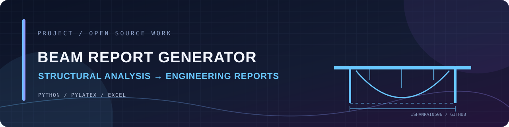

<!-- PROJECT BANNER -->

# Structural Beam Analysis Report Generator

### From beam-analysis data to polished PDF reports

A Python project that reads structural beam-analysis data from Excel and generates formatted PDF reports, including shear-force and bending-moment diagrams.

  
  

---

## ✨ What it does

**01 / Excel input**  
Read beam-analysis data from spreadsheet files.

**02 / PDF reports**  
Generate formatted engineering reports.

**03 / SFD and BMD**  
Create vector-based shear-force and bending-moment diagrams.

**04 / Visual context**  
Include beam images and analysis in the report.

## 🧰 Tech stack

Python · PyLaTeX · Excel · Matplotlib

## 📝 Notes

The current README describes report generation from Excel input. Check the repository's requirements and sample input files before running.

## 🤝 Contributing

Ideas, bug reports and thoughtful improvements are welcome. Open an issue to discuss a change before submitting a pull request.

## 👨‍💻 Maintainer

**Ishan Rai** · [GitHub](https://github.com/IshanRai0506) · [LinkedIn](https://linkedin.com/in/ishanrai-tech)

---

*Built with curiosity. Improved one commit at a time.* ✨

